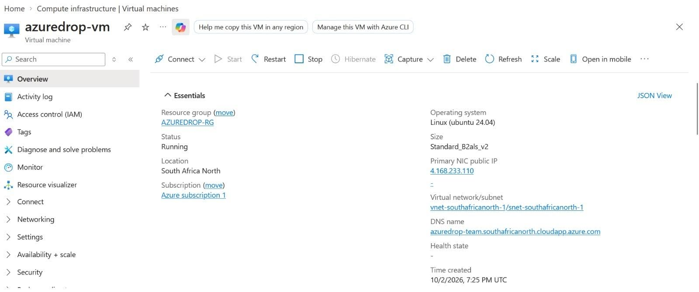
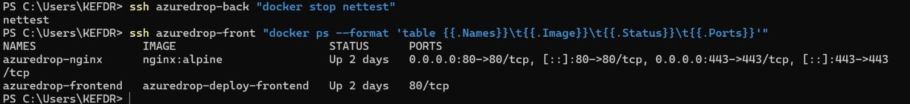
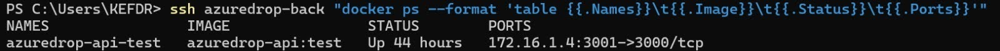

# AzureDrop — Secure File Upload Platform

Group 5, Cohort 8 capstone project for the Techcrush Cloud Computing bootcamp.

**Live application:** https://azuredrop-team.southafricanorth.cloudapp.azure.com/

## 1. Project overview

AzureDrop is a secure web application that lets users upload, store, manage and
share files through a cloud-based platform. Files are stored in Azure Blob Storage
(not on the app server), file details are kept in PostgreSQL, and the whole app
runs in Docker containers on an Azure Virtual Machine.

Application type: cloud-based file management / upload application.

## 2. Project objectives

- **Secure file management:** upload, download and manage files, with file type and size validation.
- **Cloud storage:** files in Azure Blob Storage, user and file details in PostgreSQL.
- **Authentication and access control:** users can only reach their own files.
- **Secure file sharing:** temporary links that expire and can be revoked.
- **Reliable cloud deployment:** Azure VM with Docker, Nginx, HTTPS and Managed Identity.
- **Automated delivery and availability:** GitHub Actions for CI/CD and a health check.

## 3. Features

| Feature | Status |
|---|---|
| User registration and login (JWT, 1 hour) | Done |
| Forgot / reset password | Done (the reset link is only emailed if SMTP is set up; otherwise it is printed in the server log) |
| File upload and download | Done |
| File type and size validation (10 MB; PDF, Word, TXT, JPEG, PNG) | Done |
| File categories | Done |
| File search (by filename and/or category) | Done |
| Temporary sharing links (expire, public access without login, revocable) | Done |
| File metadata | Done |
| Delete file (with confirmation) | Done |
| `/health` endpoint | Done |
| React frontend (all screens, light and dark theme, responsive) | Done |
| Docker Compose, Nginx reverse proxy, HTTPS | Done on the Azure VM |
| GitHub Actions CI/CD (automatic deploy to the Azure VM) | Done |

## 4. Architecture and technology

```
Browser  --HTTPS-->  Nginx (reverse proxy, on the VM)
                       |-- /api/...  -->  API container (Node.js + Express, port 3000)
                       |                    |-- Azure Database for PostgreSQL (users, files, share links)
                       |                    `-- Azure Blob Storage (the actual files)
                       `-- everything else --> Frontend container (React build, served by Nginx)
```

Three containers run together with Docker Compose: `api`, `frontend` and `nginx`.
The Nginx proxy sends `/api/...` to the API (with `/api` removed) and everything
else to the frontend. PostgreSQL is **not** a container: it is the Azure managed
database and needs SSL. On the VM the API reaches Blob Storage using a Managed
Identity, so no storage key is stored there.

The backend is layered: routes, middleware, controllers, models and config.
A request goes through authentication and business logic before it touches the
database or Blob Storage. More detail: [docs/architecture.md](docs/architecture.md).

**The deployment on Azure**

The VM in the Azure portal (South Africa North, Ubuntu 24.04, with a public IP and DNS name):



The frontend VM runs the Nginx proxy and the frontend container. Ports 80 and 443 are open:



The API container runs on a separate backend VM. It listens on a private address only, so it cannot be reached from the internet:



| Layer | Technology |
|---|---|
| Cloud | Microsoft Azure (VM, Database for PostgreSQL, Blob Storage) |
| Frontend | React 18, Vite, React Router, Tailwind CSS |
| Backend | Node.js, Express 5 |
| Database | PostgreSQL |
| File storage | Azure Blob Storage |
| Auth | JWT, bcryptjs |
| Containers | Docker, Docker Compose |
| Reverse proxy | Nginx |
| HTTPS | Let's Encrypt certificate |
| CI/CD | GitHub Actions |
| Security | HTTPS/TLS, Managed Identity, Azure network security group |

## 5. Run it with Docker (recommended)

You need Git, Docker and Docker Compose, plus a PostgreSQL database the API can
reach (for example the Azure one).

```bash
git clone https://github.com/Coolsammy52/azuredrop-capstone-g5-c8.git
cd azuredrop-capstone-g5-c8
git checkout g5develop

cp backend/.env.example backend/.env     # then fill in the values (see the table below)
```

Create the tables once, before the first start (from any machine that can reach the database):

```bash
cd backend
npm install
psql -d <your_db> -f src/config/schema.sql   # creates users, files, shared_links
npm run migrate                              # extra indexes + password reset table
cd ..
```

Start everything (the first run needs `--build`):

```bash
docker compose up -d --build
```

Then open:

- App: http://localhost
- API health check: http://localhost/api/health (should return `{"status":"healthy",...}`)

Useful commands: `docker compose logs -f api` (see API logs), `docker compose down` (stop).

### Environment variables

Set these in `backend/.env`. Never commit this file. Use placeholders in docs and chat.

| Variable | Needed? | Notes |
|---|---|---|
| `PORT` | optional | Defaults to 3000. Keep 3000 for Docker, because Nginx forwards to it. |
| `DB_HOST`, `DB_PORT`, `DB_USER`, `DB_PASSWORD`, `DB_NAME` | required | PostgreSQL connection |
| `DB_SSL` | required for Azure DB | `true`. Leave empty for a local database. |
| `DB_SSL_REJECT_UNAUTHORIZED` | optional | Set `false` only if SSL fails with a certificate error |
| `JWT_SECRET` | required | Long random string used to sign login tokens |
| `AZURE_STORAGE_CONTAINER` | required | Blob container name |
| `AZURE_STORAGE_ACCOUNT_NAME` | on the VM | Uses Managed Identity. The VM identity needs the roles *Storage Blob Data Contributor* and *Storage Blob Delegator*. |
| `AZURE_STORAGE_CONNECTION_STRING` | local only | Contains a key. Leave empty on the VM. |
| `FRONTEND_URL` | optional | Used in password reset links |
| `SMTP_HOST`, `SMTP_PORT`, `SMTP_SECURE`, `SMTP_USER`, `SMTP_PASS`, `MAIL_FROM` | optional | Without `SMTP_HOST`, reset links are printed in the server log |
| `SHARE_DEFAULT_EXPIRY_MINUTES`, `SHARE_MAX_EXPIRY_MINUTES` | optional | Share link limits (defaults 60 and 10080) |

The frontend needs one build setting, `VITE_API_URL`. The frontend Dockerfile sets
it to `/api`, so you do not need to touch it for Docker.

## 6. Run it for development (without Docker)

You need Node 18+ and PostgreSQL.

```bash
# Backend
cd backend
npm install
cp .env.example .env
psql -d <your_db> -f src/config/schema.sql
npm run migrate
npm start                  # http://localhost:3000/health

# Frontend (second terminal)
cd frontend
npm install
cp .env.example .env       # VITE_API_URL defaults to http://localhost:3000
npm run dev                # http://localhost:5173
```

Set `FRONTEND_URL` in `backend/.env` to the frontend address so password reset
links work. More: [docs/backend-setup.md](docs/backend-setup.md) and [frontend/README.md](frontend/README.md).

## 7. Deployment

AzureDrop is deployed on an Azure Virtual Machine with Docker. The steps were:

1. Create the Azure resources (VM, PostgreSQL, storage account, network rules).
2. Configure the VM and networking (the network security group allows only the needed ports).
3. Install Docker on the VM.
4. Pull the project from GitHub.
5. Create `backend/.env` on the VM (secrets live only there).
6. Run `docker compose up -d --build`.
7. Nginx reverse proxy sends `/api` to the API and the rest to the frontend.
8. HTTPS with a Let's Encrypt certificate, with HTTP redirected to HTTPS.
9. Connect the API to Azure PostgreSQL (SSL) and Blob Storage (Managed Identity).
10. GitHub Actions deploys automatically (`.github/workflows/deploy.yml`): on a push it
    connects to the VM over SSH, pulls the latest code, rebuilds the containers with
    `docker compose up -d --build`, runs the database migrations and checks `/api/health`.
    The VM address and SSH key are stored as GitHub secrets, never in the repo.

Live application: https://azuredrop-team.southafricanorth.cloudapp.azure.com/

## 8. API overview

Everything except register, login, forgot/reset password, `/health` and
`GET /share/:token` needs the header `Authorization: Bearer <token>`.
Behind Nginx, put `/api` in front of every path (for example `/api/files`).

| Area | Endpoints |
|---|---|
| Auth | `POST /auth/register`, `POST /auth/login`, `GET /auth/me`, `POST /auth/forgot-password`, `POST /auth/reset-password` |
| Files | `POST /files/upload`, `GET /files`, `GET /files/:id/download`, `DELETE /files/:id` |
| Categories | `PATCH /files/:id/category`, `GET /files/categories`, `GET /files/category/:category` |
| Search | `GET /files/search?query=&category=&page=&limit=` |
| Metadata | `GET /files/:id/metadata` |
| Share links | `POST /files/:id/share`, `GET /files/:id/shares`, `DELETE /shares/:token`, `GET /share/:token` (public) |
| Health | `GET /health` |

Request and response details: [docs/features-api.md](docs/features-api.md).

## 9. Tests

`npm run test:e2e` (from `backend/`) runs the automated checks against a real
**test** database. See [docs/backend-setup.md](docs/backend-setup.md), section 6.

## 10. More documentation

| Doc | What it covers |
|---|---|
| [docs/architecture.md](docs/architecture.md) | Big picture, backend layers, schema, endpoints |
| [docs/features-api.md](docs/features-api.md) | Categories, search, share links, metadata, password reset |
| [docs/backend-setup.md](docs/backend-setup.md) | Running the backend, environment variables, tests |
| [docs/troubleshooting.md](docs/troubleshooting.md) | Common problems and fixes |
| [frontend/README.md](frontend/README.md) | Running the frontend, routes, behaviour notes |
| [frontend/design-system/](frontend/design-system/) | UI style guide and component sheet |
| [docs/optional/](docs/optional/) | Frontend guide and a plain-English "why we built it this way" |

The full project report (development log, step-by-step explanation of
authentication, upload/download and validation, and results) is in the group's
report document, which is kept alongside this repository.

## 11. Project team

CAPSTONE Group 5 - techcrushcohort8

| Work track | Responsibilities |
|---|---|
| Backend / Application and Frontend | API, application logic, authentication, file operations, user interface, design system |
| Azure infra and Storage | PostgreSQL, Azure Blob Storage, data management |
| Deployment | Azure VM, Docker, Nginx, networking |
| Security / Monitoring / Documentation | Access control, HTTPS, health checks, monitoring |
| CI/CD | GitHub Actions |
| QA testing | Testing and deployment validation |

Member names are listed in the group report.

## 12. Status

Backend, frontend, containers, HTTPS and the GitHub Actions deployment are all done,
and the app is live on the Azure VM. The remaining step is the QA team's full test
of the live site (accounts, upload, download, share links, delete and security).

This project was developed as part of the Group 5, Cohort 8 cloud computing capstone.
